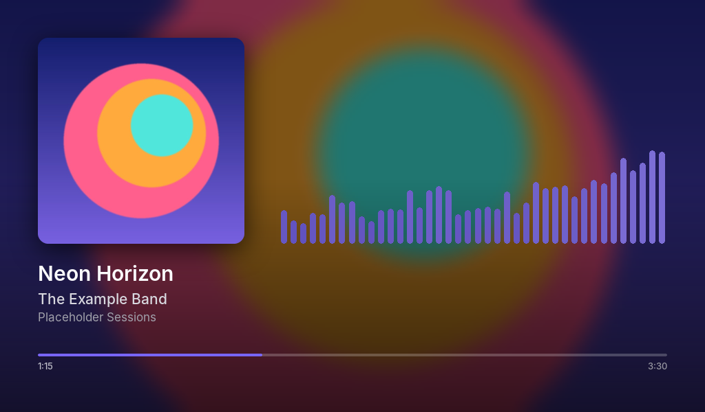

# airplay-viz

A now-playing screen for a Raspberry Pi AirPlay receiver. It shows the album art and track info, plus equalizer bars coloured from the cover, on an HDMI display. It doesn't need a desktop or a browser.



- Album art with title, artist, album and a progress bar
- 40 equalizer bars, coloured to match each album cover
- A blurred copy of the cover as the background, with a crossfade between tracks
- An idle screen when nothing is playing
- It draws straight to the screen through SDL's KMSDRM driver. On a Pi 5 it uses about 18% of one CPU core.

## How it works

```
iPhone ──AirPlay──► shairport-sync ──► ALSA "airplay" pcm ─┬─► USB DAC ──► amp
                         │                                 └─► snd-aloop loopback
                         │ metadata pipe                              │
                         │ (title/artist/album/cover/progress)        │ cava (raw output, FFT)
                         ▼                                            ▼
                   airplay-viz.py  (pygame on KMSDRM, HDMI display, tty1)
```

- **shairport-sync** is the AirPlay receiver. Its output goes to an ALSA `multi` device, which sends the audio to both the USB DAC and an `snd-aloop` loopback. The loopback runs on the DAC's clock (`timer_source`), so the two copies don't drift apart.
- **cava** reads the loopback and calculates the bar heights. It runs as a hidden subprocess in raw output mode.
- **airplay-viz.py** reads the bar heights from cava, and the track info and cover art from shairport's metadata pipe. It draws the screen with pygame and uses Pillow for the blur, the rounded corners and the colour picked from the cover.
- shairport only sends track info when a track starts. So the display saves the current track to `~/.cache/airplay-viz/` and restores it after a restart, as long as an AirPlay session is still connected.

## Tested setup

- Raspberry Pi 5, Debian 13 (trixie), arm64
- shairport-sync 4.3.7 (Debian package, classic AirPlay)
- USB DAC: KM-HIFI-384KHZ (ALSA card id `KMHIFI384KHZ`, mixer `PCM`)
- 1024×600 HDMI display (the layout scales to the screen size)

## Install

```sh
sudo apt install shairport-sync cava python3-pygame python3-pil fonts-inter
```

1. **Loopback device**
   ```sh
   sudo cp config/modprobe/snd-aloop.conf /etc/modprobe.d/snd-aloop.conf
   sudo cp config/modprobe/modules-load-snd-aloop.conf /etc/modules-load.d/snd-aloop.conf
   sudo modprobe snd-aloop
   ```
   `timer_source` must name your DAC's ALSA card id. Run `aplay -l` to find it.

2. **ALSA split output**: `sudo cp config/alsa/asound.conf /etc/asound.conf`. Change `KMHIFI384KHZ` to your DAC's card id.

3. **shairport-sync**: merge `config/shairport-sync.conf` into `/etc/shairport-sync.conf`. These settings matter:
   - `output_device = "airplay"` sends the audio through the split output.
   - `disable_standby_mode = "always"` keeps the loopback running between songs. Without it, cava gets I/O errors when playback stops.
   - The `metadata` block, with `include_cover_art = "yes"`, provides the track info and cover art.
   - `audio_backend_latency_offset_in_seconds = -1.0` is optional. It makes play, pause and skip respond about 1 second faster than AirPlay's default of about 2 seconds.

4. **PipeWire / WirePlumber** (only if your system runs it): WirePlumber normally takes over the DAC and the loopback, which blocks shairport and cava. Copy `config/wireplumber/50-airplay-usb-dac.conf` to `~/.config/wireplumber/wireplumber.conf.d/`, change the `device.name` values to match `wpctl inspect`, then run `systemctl --user restart wireplumber`.

5. **The display**
   ```sh
   mkdir -p ~/airplay-viz && cp airplay-viz.py test-meta.py ~/airplay-viz/
   sudo cp systemd/airplay-viz.service /etc/systemd/system/
   # edit User=, the ExecStart path and AIRPLAY_VIZ_NAME to suit your setup
   sudo systemctl disable --now getty@tty1
   sudo systemctl daemon-reload
   sudo systemctl enable --now airplay-viz shairport-sync
   ```
   The service user needs to be in the `video`, `render` and `audio` groups.

## Customising

| What | Where |
|---|---|
| Idle-screen name | `AIRPLAY_VIZ_NAME` in the service file |
| Number of bars, frame rate | `BARS`, `FPS` in `airplay-viz.py` |
| Bar smoothing / auto-sensitivity | `write_cava_conf()` in `airplay-viz.py` (`noise_reduction`, `autosens`) |
| Background blur / brightness | `blurred_background()` |
| How the colour is picked from the cover | `accent_from()` |

## Testing without a phone

```sh
# fake track (any JPEG/PNG cover)
python3 ~/airplay-viz/test-meta.py cover.jpg "Title" "Artist" "Album"
python3 ~/airplay-viz/test-meta.py end

# screenshot of the current frame -> /tmp/airplay-viz.png
kill -USR1 $(systemctl show -p MainPID --value airplay-viz)
```

To get moving bars without a phone, stop shairport-sync and mute the DAC (`amixer -c <card> sset PCM mute`). Then play test noise through the same path with `speaker-test -D airplay -c 2 -r 44100 -t pink`.

## Limitations

- Classic AirPlay (version 1) only, which is what Debian's shairport-sync package supports.
- Text uses Inter, with DejaVu Sans as a fallback. Install a CJK font and add it as another fallback to display Chinese, Japanese or Korean titles.
- The colour picker uses the cover's most prominent vivid colour. That isn't always the most eye-catching one.
